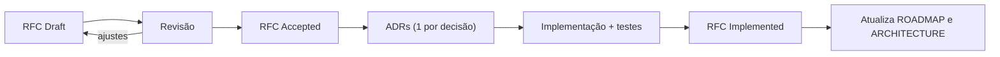

# Documentação

| Documento | Descrição |
|---|---|
| [challenge/CHALLENGE.md](challenge/CHALLENGE.md) | Enunciado original do desafio |
| [ROADMAP.md](ROADMAP.md) | Fases, status, decisões tomadas e mapa requisito → fase |
| [adr/](adr/README.md) | Architecture Decision Records (MADR) |
| [rfc/](rfc/README.md) | RFCs de desenho por fase |
| [diagrams/](diagrams/) | Diagramas (ER, sequência, estados) em mermaid |
| [runbooks/](runbooks/) | Procedimentos operacionais (DLQ, reconciliação, outbox lag) |
| [../ARCHITECTURE.md](../ARCHITECTURE.md) | Visão consolidada da arquitetura |

## Fluxo de trabalho

