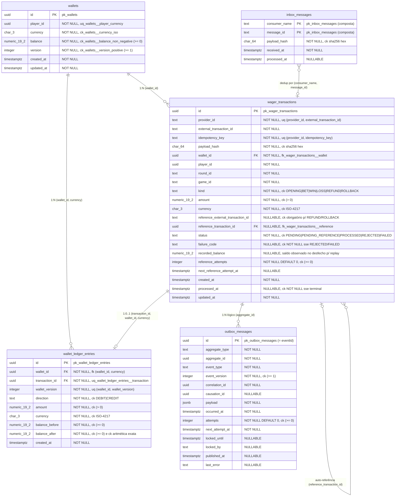
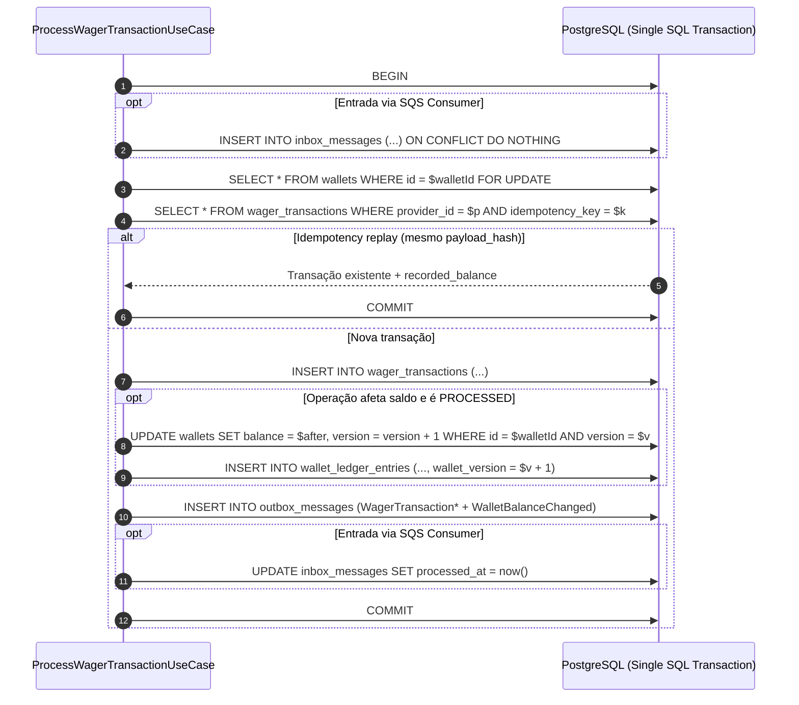

# Diagrama Entidade-Relacionamento (ER) e Design Relacional

Referência visual do modelo de dados especificado no [RFC-0002](../rfc/RFC-0002-modelagem-de-dados-e-relacionamentos.md).

## 1. Diagrama ER Completo

## 2. Fluxo Transacional Atômico no Banco

Todas as escritas abaixo ocorrem dentro de uma única transação SQL (`READ COMMITTED`) coordenada pelo
`UnitOfWork` com lock pessimista na linha da `wallet`:

