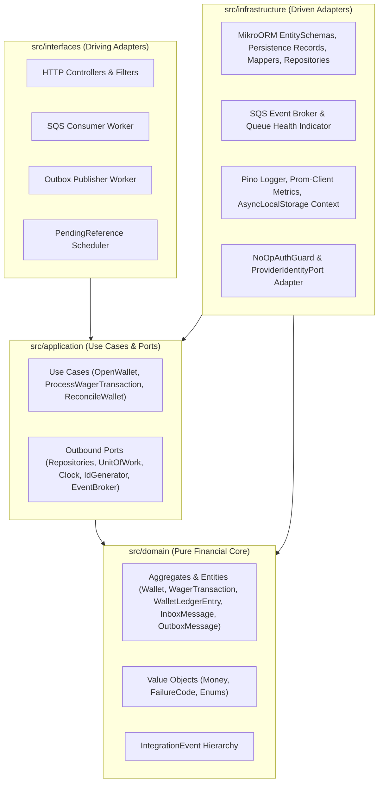

# RFC-0001 — Stack tecnológica, scaffolding hexagonal e topologia de execução

## 1. Resumo

Define a fundação tecnológica do **Distributed Wagering Processor**: runtime (**Bun 1.x**), linguagem
(**TypeScript strict**), framework (**NestJS 11**), persistência (**PostgreSQL 17 + MikroORM v6** com
`EntitySchema`), mensageria (**AWS SDK v3 SQS + MiniStack**), estrutura de diretórios em **Arquitetura
Hexagonal (Ports & Adapters)** e topologia de execução em **monólito modular orientando papéis via variável de
ambiente (`APP_ROLE`)**, orquestrado localmente com **Docker Compose** rodando múltiplas réplicas.

## 2. Contexto e motivação

O enunciado ([docs/challenge/CHALLENGE.md](../challenge/CHALLENGE.md)) estabelece:

- **Seção 4 (Stack)**: Bun 1.x (runtime, package manager e test runner), TypeScript em modo estrito, NestJS,
  PostgreSQL, AWS SQS via LocalStack ou MiniStack, Docker Compose e migrations versionadas e reversíveis.
  Para ORM, exige MikroORM (preferencial) ou TypeORM, proibindo Prisma e outros ORMs.
- **Seção 5 (Restrições invioláveis)**: solução correta com **múltiplas instâncias** da aplicação (item 8).
- **Seção 6.1 (Money)**: o domínio **não** pode depender de tipos monetários do ORM nem de decorators do NestJS.
- **Seção 12 (Observabilidade)**: logs estruturados JSON, métricas e health checks separados (`live` e `ready`).
- **Seção 13 (Testes)**: testes de integração e concorrência contra PostgreSQL e SQS reais em containers, com
  cenários exigindo **≥ 3 processos/instâncias** simultâneos.

Precisamos de uma estrutura de projeto e de execução que:
1. Isole completamente `src/domain` de frameworks (zero imports de NestJS, MikroORM, Zod ou AWS SDK).
2. Permita subir múltiplos processos/réplicas no mesmo `docker compose up` sem duplicar código.
3. Rode com zero fricção para qualquer avaliador (sem exigir contas externas ou tokens pagos/proprietários).

## 3. Objetivos e não-objetivos

**Objetivos**

- Definir cada biblioteca da stack e sua responsabilidade exata.
- Definir a árvore de diretórios hexagonal (`domain`, `application`, `infrastructure`, `interfaces`) e as
  regras de dependência entre camadas.
- Definir a topologia de execução (`APP_ROLE=api|consumer|outbox|scheduler|all`) para suportar ≥ 3 instâncias
  concorrentes.
- Definir a infraestrutura local em `docker-compose.yml` (PostgreSQL 17, MiniStack para SQS + provisionamento
  automático das filas FIFO e DLQ).
- Validar a integração **Bun + NestJS + MikroORM + PostgreSQL** logo na Fase 1 para eliminar riscos de
  metadados TypeScript (`emitDecoratorMetadata`) ou empacotamento.

**Não-objetivos**

- Definir o schema detalhado das tabelas financeiras (escopo do [RFC-0002](RFC-0002-modelagem-de-dados-e-relacionamentos.md)).
- Implementar regras de negócio de apostas ou workers (fases 3 a 8).

## 4. Desenho proposto

### 4.1 Stack consolidada

| Camada | Biblioteca / Ferramenta | Versão alvo | Justificativa resumida | ADR |
|---|---|---|---|---|
| Runtime / PM / Test runner | **Bun** | `1.2+` | Obrigatório; execução nativa de TS, `Bun.randomUUIDv7()`, `bun test` rápido | [ADR-0002](../adr/0002-adotar-stack-base-bun-typescript-nestjs-postgres.md) |
| Linguagem | **TypeScript** | `5.8+` (`strict: true`) | `noUncheckedIndexedAccess`, `exactOptionalPropertyTypes`, `noImplicitOverride` | [ADR-0002](../adr/0002-adotar-stack-base-bun-typescript-nestjs-postgres.md) |
| Framework DI / HTTP | **NestJS** (`@nestjs/core`, `@nestjs/common`, `@nestjs/platform-express`) | `11.x` | Obrigatório; modularidade, ciclo de vida (`OnApplicationShutdown`) | [ADR-0002](../adr/0002-adotar-stack-base-bun-typescript-nestjs-postgres.md) |
| Banco de dados | **PostgreSQL** | `17-alpine` | Obrigatório; suporte robusto a `NUMERIC(19,2)`, `FOR UPDATE`, `SKIP LOCKED`, partial unique indexes | [ADR-0002](../adr/0002-adotar-stack-base-bun-typescript-nestjs-postgres.md) |
| ORM & Migrations | **MikroORM** (`@mikro-orm/core`, `@mikro-orm/postgresql`, `@mikro-orm/migrations`) | `6.x` | Preferencial no desafio; Unit of Work explícito, `em.transactional()`, `LockMode.PESSIMISTIC_WRITE`, `EntitySchema` desacoplado do domínio | [ADR-0003](../adr/0003-usar-mikroorm-com-entity-schema-sem-decorators-no-dominio.md) |
| IDs | **UUIDv7** (`Bun.randomUUIDv7()`) | Nativo | Ordenável por tempo (localidade em páginas B-tree no Postgres), 128 bits, gerado na aplicação | [ADR-0004](../adr/0004-gerar-identificadores-com-uuidv7-na-aplicacao.md) |
| Mensageria (SDK) | **AWS SDK v3** (`@aws-sdk/client-sqs`) | `3.x` | Cliente oficial, leve, suporte nativo a FIFO e `ChangeMessageVisibility` | [ADR-0005](../adr/0005-adotar-ministack-como-emulador-sqs-padrao.md) |
| Emulador AWS SQS | **MiniStack** (`ministackorg/ministack`) | `latest` | Drop-in na porta `4566` sem exigir `LOCALSTACK_AUTH_TOKEN`; compatível com LocalStack via `AWS_ENDPOINT_URL` | [ADR-0005](../adr/0005-adotar-ministack-como-emulador-sqs-padrao.md) |
| Validação de borda | **Zod** | `3.24+` / `4.x` | Parsing estrito nos DTOs HTTP/SQS e variáveis de ambiente, sem poluir o domínio | [ADR-0002](../adr/0002-adotar-stack-base-bun-typescript-nestjs-postgres.md) |
| Logs estruturados | **Pino** (`nestjs-pino`, `pino`) | `9.x` | JSON estruturado de baixa latência, redaction nativo | [ADR-0002](../adr/0002-adotar-stack-base-bun-typescript-nestjs-postgres.md) |
| Métricas | **prom-client** | `15.x` | Contadores, gauges e histogramas Prometheus em `/metrics` | [ADR-0002](../adr/0002-adotar-stack-base-bun-typescript-nestjs-postgres.md) |
| Health checks | **@nestjs/terminus** | `11.x` | Endpoints `/health/live` e `/health/ready` | [ADR-0002](../adr/0002-adotar-stack-base-bun-typescript-nestjs-postgres.md) |
| Lint & Format | **Biome** (`@biomejs/biome`) | `1.9+` | Linter e formatter unificados e extremamente rápidos | [ADR-0002](../adr/0002-adotar-stack-base-bun-typescript-nestjs-postgres.md) |

### 4.2 Arquitetura Hexagonal e árvore de diretórios



Estrutura de diretórios:

```text
src/
├── domain/
│   ├── wallet/              # Wallet, WalletLedgerEntry, LedgerDirection
│   ├── wagering/            # WagerTransaction, WagerTransactionKind, WagerTransactionStatus
│   ├── messaging/           # InboxMessage, OutboxMessage, IntegrationEvent (+ subclasses)
│   ├── shared/              # Money, FailureCode, DomainError, InvalidTransactionStateError
│   └── index.ts
├── application/
│   ├── ports/               # WalletRepository, WagerTransactionRepository, UnitOfWork, Clock, IdGenerator...
│   ├── use-cases/           # OpenWalletUseCase, ProcessWagerTransactionUseCase, ReconcileWalletUseCase...
│   └── dto/                 # Comandos e resultados de aplicação
├── infrastructure/
│   ├── config/              # Env validation (Zod)
│   ├── persistence/
│   │   ├── schemas/         # MikroORM EntitySchema (Persistence Records separados das classes de domínio)
│   │   ├── mappers/         # Domain <-> Persistence Record (usando Foo.rehydrate())
│   │   ├── repositories/    # Implementações MikroORM dos repositórios
│   │   ├── migrations/      # Migrations SQL explícitas (up/down)
│   │   └── unit-of-work.ts  # Wrapper sobre EntityManager.transactional()
│   ├── messaging/           # Cliente SQS, publicador de eventos
│   ├── observability/       # Logger, métricas Prometheus, CorrelationId store
│   └── auth/                # ProviderIdentityPort e guard
├── interfaces/
│   ├── http/                # Controllers, ZodValidationPipe, GlobalExceptionFilter
│   ├── sqs/                 # SqsWagerConsumer (long polling, ack pós-commit, graceful shutdown)
│   └── workers/             # OutboxPublisherWorker, PendingReferenceWorker
├── app.module.ts            # Composição condicional por APP_ROLE
└── main.ts                  # Bootstrap e hooks de SIGTERM/SIGINT
test/
├── unit/                    # Testes rápidos sem I/O (src/domain, mappers, canonical hash)
├── integration/             # PostgreSQL + MiniStack reais (schema constraints, repos, outbox, consumer)
├── concurrency/             # Os 8 cenários obrigatórios com paralelismo real e múltiplos processos
└── helpers/                 # Fixtures, asserção universal assertWalletMatchesLedger(walletId)
```

### 4.3 Topologia de execução por papéis (`APP_ROLE`)

Uma única imagem/codebase suporta papéis configuráveis via `APP_ROLE` (com lista separada por vírgula ou `all`):

- `api`: expõe os endpoints HTTP (`/wallets`, `/wagering/transactions`, `/health/*`, `/metrics`).
- `consumer`: executa o loop de long-polling da fila `wager-transactions.fifo`.
- `outbox`: executa o publisher da Transactional Outbox com `FOR UPDATE SKIP LOCKED`.
- `scheduler`: executa o reprocessamento periódico de transações em `PENDING_REFERENCE`.
- `all` (default no desenvolvimento e nas réplicas do `docker-compose.yml`): ativa todos os módulos no mesmo
  processo, permitindo subir **3 instâncias idênticas** (`app-1`, `app-2`, `app-3`) que disputam tanto a fila
  SQS quanto a outbox e as wallets no PostgreSQL.

## 5. Invariantes e garantias

| Invariante | Onde é garantida | Como é testada |
|---|---|---|
| `src/domain` não depende de NestJS, MikroORM, Zod ou AWS SDK | Arquitetura / Lint | Teste estático de imports em `test/unit/architecture.spec.ts` |
| DI do NestJS funciona em Bun sem perda de metadados | `tsconfig.json` (`emitDecoratorMetadata: true`, `experimentalDecorators: true`) + injeção explícita via tokens | Teste de bootstrap da aplicação na Fase 1 |
| Filas `wager-transactions.fifo` e `wager-transactions-dlq.fifo` existem antes do readiness | Script de init do MiniStack + check no `/health/ready` | Teste de integração de readiness |
| Múltiplas instâncias iniciam e desligam graciosamente em `SIGTERM` | `app.enableShutdownHooks()` + controle de visibilidade no consumer | Teste de integração de shutdown |

## 6. Modos de falha

| Falha | Comportamento esperado | Teste |
|---|---|---|
| Variável de ambiente inválida ou ausente no boot | Processo falha imediatamente no startup (`exit 1`) com erro estruturado do Zod | Teste unitário do módulo de config |
| PostgreSQL indisponível no startup ou durante execução | `/health/ready` retorna `503 Service Unavailable`; `/health/live` permanece `200 OK` | Teste de integração de health check |
| SQS (MiniStack/LocalStack) indisponível | `/health/ready` retorna `503 Service Unavailable`; outbox mantém eventos com retry | Teste de integração de health check |
| Recebimento de `SIGTERM` durante processamento | `enableShutdownHooks` interrompe novos polls, aguarda operações em voo (até timeout) e fecha conexões | Teste de integração na Fase 6 |

## 7. Alternativas consideradas

1. **TypeORM vs MikroORM**: TypeORM é aceito, mas MikroORM é preferencial no enunciado e oferece Unit of Work
   explícito e `EntitySchema` que dispensa decorators nas entidades de domínio ([ADR-0003](../adr/0003-usar-mikroorm-com-entity-schema-sem-decorators-no-dominio.md)).
2. **UUIDv4 no banco vs UUIDv7 na aplicação**: UUIDv4 fragmenta índices B-tree sob alta escrita; UUIDv7 é
   monotônico por milissegundo e gerado sem round-trip ([ADR-0004](../adr/0004-gerar-identificadores-com-uuidv7-na-aplicacao.md)).
3. **LocalStack vs MiniStack**: a imagem unificada do LocalStack passou a exigir `LOCALSTACK_AUTH_TOKEN`.
   MiniStack é 100% open-source, não requer conta/token e responde na mesma porta `4566` ([ADR-0005](../adr/0005-adotar-ministack-como-emulador-sqs-padrao.md)).
4. **Repositórios separados por microserviço vs Modular Monolith por `APP_ROLE`**: múltiplos builds tornariam o
   setup lento e propenso a drift; uma única base parametrizada por `APP_ROLE` permite rodar tudo junto ou
   escalar papéis separadamente ([ADR-0006](../adr/0006-topologia-modular-monolith-por-papeis.md)).

## 8. Observabilidade

- Logger JSON via `nestjs-pino` configurado desde a Fase 1, com `redact` para headers de autorização e
  qualquer campo sensível.
- Endpoint `/health/live` (liveness: loop de eventos ativo) e `/health/ready` (readiness: `SELECT 1` no
  PostgreSQL + `GetQueueUrlCommand` nas filas SQS).

## 9. Plano de testes

- **Unidade**: validação de variáveis de ambiente (`env.spec.ts`) e teste de fronteiras arquiteturais
  (`architecture.spec.ts` garantindo que `src/domain` não importa pacotes externos).
- **Integração**: subir PostgreSQL + MiniStack via Compose, executar spike de transação MikroORM e verificar
  `/health/live` e `/health/ready`.

## 10. Plano de implementação

- [x] Criar ADRs 0002, 0003, 0004, 0005 e 0006.
- [x] Inicializar `package.json`, `tsconfig.json`, `biome.json` e `.env.example`.
- [x] Criar `docker-compose.yml` com PostgreSQL 17, MiniStack e script de provisionamento das filas FIFO/DLQ.
- [x] Criar esqueleto hexagonal em `src/` com `AppModule`, config Zod e health checks (`/health/live`, `/health/ready`).
- [x] Validar spike Bun + NestJS + MikroORM + PostgreSQL + MiniStack com teste automatizado.

## 11. Riscos e questões em aberto

- **Risco**: Bun não exige compilação `tsc` para rodar, mas o DI do NestJS depende de `emitDecoratorMetadata` ou
  de `@Inject()` explícito nos construtores. **Mitigação**: habilitar `experimentalDecorators` e
  `emitDecoratorMetadata` no `tsconfig.json` **e** usar `@Inject(TOKEN)` explícito nos serviços e controllers,
  tornando a injeção independente de reflection implícita.

