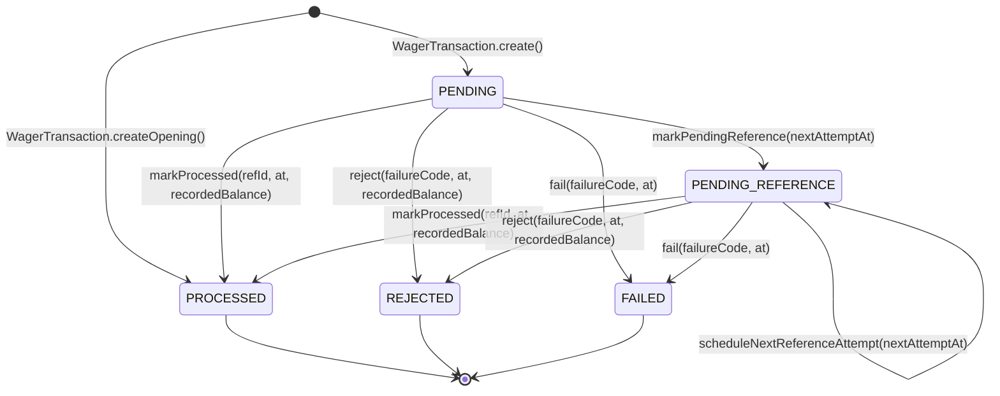

# RFC-0003 — Modelo de domínio puro, políticas declarativas e máquina de estados

## 1. Resumo

Especifica o núcleo de domínio (`src/domain/`) do **Distributed Wagering Processor**: `Money`, `Wallet`,
`WagerTransaction`, `WalletLedgerEntry`, `InboxMessage`, `OutboxMessage`, a hierarquia de `IntegrationEvent` e a
taxonomia de `FailureCode` / erros de domínio. Todas as classes seguem o padrão de **construtor `private` ou
`protected` + factories estáticas** (`from`, `zero`, `open`, `create`, `receive`, `enqueue`, `rehydrate`), e as
regras de transição de estado, direção de ledger e políticas por `WagerTransactionKind` são expressas por
**Lookup Tables / Strategy Maps declarativos (`Record<K, Policy>`)**, eliminando cadeias de `if / else` e
`switch`.

## 2. Contexto e motivação

O enunciado ([docs/challenge/CHALLENGE.md](../challenge/CHALLENGE.md)) especifica na **Seção 6** e **Seção 7**:

- **Seção 6.0**: construtor `private` ou `protected` + factories estáticas (`create`, `from`, `rehydrate`), onde
  `rehydrate` reconstrói o estado persistido sem revalidar transições.
- **Seção 6.1 (`Money`)**: imutável, escala fixa de 2 casas decimais, operações lançam erro em conflito de
  moeda, rejeita entradas inválidas (`NaN`, `Infinity`, notação científica, string vazia, mais de 2 casas,
  negativos nos contratos de entrada).
- **Seção 6.2 (`Wallet`)**: saldo nunca negativo; toda mudança de saldo em `debit`/`credit` produz um
  `WalletLedgerEntry` correspondente e incrementa `version` (que inicia em `1`).
- **Seção 6.3 (`WagerTransaction`)**: nasce em `PENDING`; `PROCESSED`, `REJECTED` e `FAILED` são terminais (tentar
  transicioná-los lança `InvalidTransactionStateError`); `OPENING` é restrito ao uso interno; expõe
  `markProcessed`, `markPendingReference`, `reject`, `fail`, `isTerminal`, `affectsBalance`,
  `requiresReference`, `matchesPayload`, `ledgerDirectionFor`.
- **Seção 6.4 (`WalletLedgerEntry`)**: estruturalmente imutável; `create` verifica `isBalanced()`
  (`balanceBefore ± money === balanceAfter`).
- **Seção 6.5 (`InboxMessage` e `OutboxMessage`)**: controle de deduplicação e agendamento de publicação com
  backoff exponencial.
- **Seção 11 (`IntegrationEvent<T>`)**: classe abstrata com `eventType` e `version` na subclasse concreta
  (`WagerTransactionProcessed`, `WagerTransactionRejected`, `WalletBalanceChanged`,
  `WagerTransactionPendingReference`).

## 3. Objetivos e não-objetivos

**Objetivos**

- Implementar 100% das entidades, Value Objects, eventos e erros da camada `src/domain` sem nenhuma dependência
  externa.
- Substituir ramificações condicionais (`if/else`/`switch`) por mapas declarativos (`KIND_POLICIES`,
  `ALLOWED_STATUS_TRANSITIONS`, `DIRECTION_ARITHMETIC`, `INVERSE_DIRECTION`).
- Garantir que `Wallet.open`, `Wallet.debit` e `Wallet.credit` mantenham saldo, versão e `WalletLedgerEntry`
  acoplados e consistentes por construção.
- Cobrir todos os cenários de unidade exigidos na Seção 13.

**Não-objetivos**

- Persistência em banco ou locks SQL (escopo da Fase 4).

## 4. Desenho proposto

### 4.1 Máquina de Estados de `WagerTransaction`



Transições permitidas declaradas como tabela imutável:

```ts
const TERMINAL_STATUSES: ReadonlySet<WagerTransactionStatus> = new Set([
  WagerTransactionStatus.Processed,
  WagerTransactionStatus.Rejected,
  WagerTransactionStatus.Failed,
]);

const ALLOWED_TRANSITIONS: Readonly<
  Record<WagerTransactionStatus, ReadonlySet<WagerTransactionStatus>>
> = {
  [WagerTransactionStatus.Pending]: new Set([
    WagerTransactionStatus.Processed,
    WagerTransactionStatus.PendingReference,
    WagerTransactionStatus.Rejected,
    WagerTransactionStatus.Failed,
  ]),
  [WagerTransactionStatus.PendingReference]: new Set([
    WagerTransactionStatus.Processed,
    WagerTransactionStatus.PendingReference,
    WagerTransactionStatus.Rejected,
    WagerTransactionStatus.Failed,
  ]),
  [WagerTransactionStatus.Processed]: new Set(),
  [WagerTransactionStatus.Rejected]: new Set(),
  [WagerTransactionStatus.Failed]: new Set(),
};
```

### 4.2 Políticas Declarativas por `WagerTransactionKind` (`KIND_POLICIES`)

Em vez de `if (kind === ...)` espalhados, cada `WagerTransactionKind` possui uma política estática em
`KIND_POLICIES`:

| Kind | `isExternalSubmissible` | `affectsBalance` | `requiresReference` | `allowedReferenceKinds` | `resolveDirection(ref?)` |
|---|---|---|---|---|---|
| `OPENING` | `false` | `true` | `false` | `[]` | `CREDIT` |
| `BET` | `true` | `true` | `false` | `[]` | `DEBIT` |
| `WIN` | `true` | `true` | `false` | `[BET]` (opcional) | `CREDIT` |
| `LOSS` | `true` | `false` | `false` | `[BET]` (opcional) | lança `DomainInvariantError` |
| `REFUND` | `true` | `true` | `true` | `[BET]` | `CREDIT` |
| `ROLLBACK` | `true` | `true` | `true` | `[BET, WIN, REFUND]` | inverso da direção de `ref` (`DEBIT ↔ CREDIT`) |

### 4.3 `Wallet` e geração atômica de `WalletLedgerEntry`

- `Wallet.open(props)` cria a carteira com `version = 1`.
- `Wallet.debit(props: { ledgerEntryId, transactionId, amount, occurredAt })` e
  `Wallet.credit(props: { ledgerEntryId, transactionId, amount, occurredAt })` validam moeda e saldo, incrementam
  `_version`, atualizam `_balance` e `_updatedAt` e retornam o `WalletLedgerEntry` recém-criado e já validado por
  `isBalanced()`.
- Quando `Wallet.open` recebe `initialBalance > 0`, o helper `Wallet.openWithOpeningLedger(...)` também instancia
  a transação interna `OPENING` (`PROCESSED`) e o `WalletLedgerEntry` inicial (`walletVersion = 1`,
  `balanceBefore = 0.00`, `balanceAfter = initialBalance`).

## 5. Invariantes e garantias

| Invariante | Onde é garantida | Como é testada |
|---|---|---|
| `Money` nunca usa `number` e rejeita formatos inválidos | Regex + `bigint` em `Money.from` | `test/unit/domain/money.spec.ts` |
| Operações entre moedas distintas falham | `Money.assertSameCurrency` e `Wallet.assertSameCurrency` | `test/unit/domain/money.spec.ts` e `wallet.spec.ts` |
| `Wallet` nunca fica com saldo negativo e `version` só sobe quando saldo muda | `Wallet.debit` / `Wallet.credit` | `test/unit/domain/wallet.spec.ts` |
| Estados terminais de `WagerTransaction` lançam `InvalidTransactionStateError` | `WagerTransaction.assertCanTransitionTo` via `ALLOWED_TRANSITIONS` | `test/unit/domain/wager-transaction.spec.ts` |
| `WalletLedgerEntry` é imutável e aritmética sempre fecha | `DIRECTION_ARITHMETIC` + `assertBalanced` em `WalletLedgerEntry.create` | `test/unit/domain/wallet-ledger-entry.spec.ts` |
| `OutboxMessage` aplica backoff exponencial determinístico | `OutboxMessage.scheduleRetry` | `test/unit/domain/inbox-outbox.spec.ts` |

## 6. Modos de falha

| Falha | Comportamento esperado | Teste |
|---|---|---|
| String monetária inválida (`"25.999"`, `"-10.00"`, `"1e5"`, `"NaN"`, `""`) | Lança `InvalidMoneyError` (`INVALID_MONEY_AMOUNT`) | `money.spec.ts` |
| Moeda inválida ou conflitante (`"BRL"` vs `"USD"`) | Lança `CurrencyMismatchError` (`CURRENCY_MISMATCH`) | `money.spec.ts`, `wallet.spec.ts` |
| Débito maior que o saldo disponível | Lança `InsufficientFundsError` (`INSUFFICIENT_FUNDS` ou `REVERSAL_WOULD_CAUSE_NEGATIVE_BALANCE`) | `wallet.spec.ts` |
| Tentativa de transicionar transação `PROCESSED`, `REJECTED` ou `FAILED` | Lança `InvalidTransactionStateError` | `wager-transaction.spec.ts` |
| Submissão externa de `OPENING` ou `REFUND`/`ROLLBACK` sem referência | Lança `DomainValidationError` | `wager-transaction.spec.ts` |

## 7. Alternativas consideradas

- **Condicionais `if/switch` nos métodos vs Tabelas de Políticas (`KIND_POLICIES` e `ALLOWED_TRANSITIONS`)**:
  escolhemos tabelas declarativas ([ADR-0010](../adr/0010-maquina-de-estados-e-politicas-declarativas-no-dominio.md)),
  eliminando ramificações repetitivas e tornando cada regra inspecionável como dado.

## 8. Observabilidade

- Os erros de domínio carregam `failureCode` tipado (`FailureCode`), que alimenta métricas por motivo de rejeição
  e logs estruturados sem expor valores monetários.

## 9. Plano de testes

- `test/unit/domain/money.spec.ts`: escala, normalização `0–2` casas, soma/subtração/negação, comparações,
  conflito de moeda, entradas inválidas.
- `test/unit/domain/wallet-ledger-entry.spec.ts`: `CREDIT`, `DEBIT`, rejeição de lançamento desbalanceado,
  `rehydrate`.
- `test/unit/domain/wallet.spec.ts`: abertura com saldo zero e positivo, `credit`, `debit`, `version`
  incrementando apenas na mudança de saldo, saldo insuficiente, conflito de moeda.
- `test/unit/domain/wager-transaction.spec.ts`: políticas de `BET`, `WIN`, `LOSS`, `REFUND`, `ROLLBACK`,
  bloqueio de `OPENING` externo, máquina de estados completa, `matchesPayload`, validação de referência.
- `test/unit/domain/inbox-outbox-events.spec.ts`: `InboxMessage`, `OutboxMessage` (backoff) e subclasses de
  `IntegrationEvent`.

## 10. Plano de implementação

- [x] Criar [ADR-0010](../adr/0010-maquina-de-estados-e-politicas-declarativas-no-dominio.md).
- [x] Implementar `FailureCode`, erros de domínio e `Money` em `src/domain/shared/`.
- [x] Implementar `LedgerDirection`, `WalletLedgerEntry` e `Wallet` em `src/domain/wallet/`.
- [x] Implementar `WagerTransactionKind`, `WagerTransactionStatus` e `WagerTransaction` em `src/domain/wagering/`.
- [x] Implementar `InboxMessage`, `OutboxMessage` e hierarquia `IntegrationEvent` em `src/domain/messaging/`.
- [x] Implementar e executar todas as suítes de testes unitários de domínio.

## 11. Riscos e questões em aberto

- Nenhum ponto em aberto.
