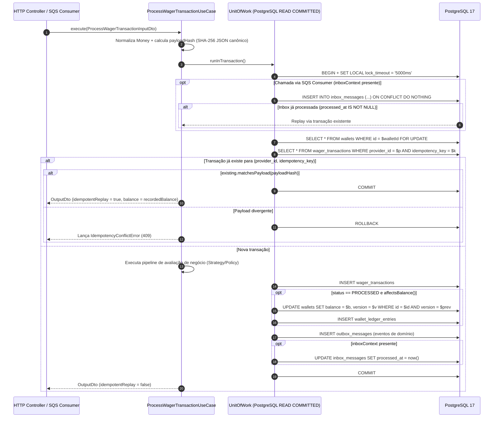

# RFC-0004 — Pipeline de processamento de apostas, concorrência por wallet e idempotência persistente

## 1. Resumo

Especifica a camada de Aplicação (`src/application/`) e os adaptadores de Persistência (`src/infrastructure/persistence/`)
responsáveis por criar carteiras (`OpenWalletUseCase`), processar transações de apostas
(`ProcessWagerTransactionUseCase`), reconciliar saldos (`ReconcileWalletUseCase`) e consultar carteiras,
transações e ledger. Define a estratégia de **lock pessimista por `walletId` (`SELECT ... FOR UPDATE`) com
defesa em profundidade**, o cálculo de **`payloadHash` canônico SHA-256**, o tratamento de **idempotência
persistente** (replay vs conflito de payload), a resolução de referências (`REFUND`/`ROLLBACK` e
`PENDING_REFERENCE`) e o desenho preparado para **auto-scaling horizontal (Terraform / ECS / KEDA)**.

## 2. Contexto e motivação

O enunciado ([docs/challenge/CHALLENGE.md](../challenge/CHALLENGE.md)) exige nas **Seções 7, 8, 9, 10 e 11**:

- **Seção 7**: regras completas para `BET`, `WIN`, `LOSS`, `REFUND` e `ROLLBACK`; resolução de referência por
  `(providerId, referenceExternalTransactionId)` validando provider, player, wallet, moeda, rodada, status
  `PROCESSED`, tipo permitido e valor exato; referência ausente persiste como `PENDING_REFERENCE`; reversão que
  causaria saldo negativo é rejeitada com `failureCode` próprio (`REVERSAL_WOULD_CAUSE_NEGATIVE_BALANCE`);
  repetir operação já processada retorna o resultado original com o saldo observado naquele momento.
- **Seção 8**: unidade de concorrência é a `walletId`; cenário obrigatório `100.00 BRL` com duas apostas
  simultâneas de `80.00 BRL` → 1 `PROCESSED`, 1 `REJECTED`, saldo final `20.00 BRL`, 1 débito no ledger.
- **Seção 9**: `POST /wallets` gera transação interna `OPENING` + lançamento `CREDIT` quando `initialBalance > 0`
  na mesma transação SQL; `Idempotency-Key` obrigatório; `payloadHash` de JSON canônico.
- **Seção 10 e 11**: o mesmo caso de uso deve ser compartilhado entre HTTP e SQS Consumer; inbox, transação,
  saldo, ledger e outbox participam da **mesma transação SQL**.

## 3. Objetivos e não-objetivos

**Objetivos**

- Definir contratos de entrada e saída (`*InputDto` / `*OutputDto`) explícitos para todos os casos de uso em
  `src/application/dto/`.
- Implementar o calculador de hash canônico SHA-256 (`CanonicalPayloadHasher`) sobre os campos de negócio
  normalizados.
- Implementar os Data Mappers (`Domain <-> Persistence Record` usando `rehydrate`) e Repositórios MikroORM.
- Implementar `OpenWalletUseCase`, `ProcessWagerTransactionUseCase`, `ReconcileWalletUseCase` e casos de uso de
  leitura (`GetWalletUseCase`, `ListWalletLedgerUseCase`, `GetWagerTransactionUseCase`).
- Provar nos testes de integração e concorrência o cenário obrigatório `100 / 80 / 80` e o cenário `50×` em
  paralelo sobre PostgreSQL 17 real.

**Não-objetivos**

- Controllers HTTP e filtros de exceção (Fase 5).
- Worker SQS Consumer (Fase 6) e Worker Outbox Publisher (Fase 7).

## 4. Desenho proposto

### 4.1 Pipeline Atômico de `ProcessWagerTransactionUseCase`



### 4.2 Algoritmo de `payloadHash` Canônico ([ADR-0012](../adr/0012-garantir-idempotencia-persistente-e-hash-canonico-sha256.md))

Apenas os campos semânticos de negócio entram no JSON canônico (chaves ordenadas lexicograficamente, `amount`
normalizado para 2 casas decimais via `Money.from`, `referenceExternalTransactionId` omitido quando `undefined`):

```json
{
  "externalTransactionId": "transaction-123",
  "gameId": "fortune-chimp",
  "kind": "BET",
  "money": { "amount": "25.00", "currency": "BRL" },
  "playerId": "0192f28f-5dc0-7d58-bdb2-814ad6a0f4a1",
  "providerId": "provider-a",
  "referenceExternalTransactionId": null,
  "roundId": "round-987",
  "walletId": "0192f291-27dd-7d3f-8071-5f8685deef37"
}
```

Hash: `SHA-256` em hexadecimal minúsculo (64 caracteres). Metadados de transporte (`Idempotency-Key` header,
`messageId`, `correlationId`, `occurredAt`) **não** entram no hash.

### 4.3 Ordem de Aquisição de Lock e Prevenção de Deadlock

1. A transação adquire **primeiro** `SELECT ... FROM wallets WHERE id = $walletId FOR UPDATE`.
2. Como todas as operações de uma mesma carteira serializam nessa linha em `READ COMMITTED`, 50 requisições
   simultâneas com a mesma `Idempotency-Key` e `walletId` aguardam na fila do lock da carteira: a primeira
   insere e confirma; as 49 seguintes leem imediatamente a transação já confirmada ao adquirir o lock e retornam
   `idempotentReplay: true` sem abortar transação.
3. Caso duas requisições com a mesma `(providerId, idempotencyKey)` apontem para `walletId` diferentes ou cheguem
   fora do lock da mesma wallet, a constraint `uq_wager_transactions__provider_idempotency_key` (`23505`) barra a
   segunda escrita; o `ProcessWagerTransactionUseCase` captura o código `23505`, consulta a transação vencedora
   e devolve replay (se o `payloadHash` for idêntico) ou `IdempotencyConflictError` (se o `payloadHash` divergir).

### 4.4 Preparação para Terraform e Auto-Scaling Horizontal

- **Stateless por design**: nenhum lock ou cache de idempotência reside em memória; 1 a N instâncias de `api`,
  `consumer`, `outbox` e `scheduler` coordenam-se exclusivamente pelo PostgreSQL e pelo SQS.
- **Proteção de conexões**: `DB_POOL_MIN`, `DB_POOL_MAX` e `SET LOCAL lock_timeout` evitam exaustão de conexões
  ao escalar réplicas via ECS Application Auto Scaling / KEDA e permitem acoplamento transparente com **RDS
  Proxy** ou **PgBouncer** em modo `transaction`.

## 5. Invariantes e garantias

| Invariante | Onde é garantida | Como é testada |
|---|---|---|
| Duas apostas simultâneas disputando o mesmo saldo (`100 / 80 / 80`) nunca geram saldo negativo | `FOR UPDATE` na wallet + `Wallet.debit` + `ck_wallets__balance_non_negative` | `test/concurrency/hot-wallet-concurrency.spec.ts` |
| Mesma aposta enviada 50× em paralelo gera exatamente 1 débito | `FOR UPDATE` + `uq_wager_transactions__provider_idempotency_key` | `test/concurrency/idempotency-50x.spec.ts` |
| Mesma `Idempotency-Key` com payload diferente retorna conflito (`409`) | `existing.matchesPayload(payloadHash)` | `test/integration/use-cases/process-wager-transaction.spec.ts` |
| Reversão (`REFUND`/`ROLLBACK`) ocorre no máximo 1 vez por referência | Lookup no repositório + `uq_wager_transactions__single_reversal` | `test/integration/use-cases/process-wager-transaction.spec.ts` |
| Reversão de `WIN`/`REFUND` sem saldo suficiente usa `REVERSAL_WOULD_CAUSE_NEGATIVE_BALANCE` | `ProcessWagerTransactionUseCase` + `Wallet.debit` | `test/integration/use-cases/process-wager-transaction.spec.ts` |

## 6. Modos de falha

| Falha | Comportamento esperado | Teste |
|---|---|---|
| Wallet inexistente | Lança `DomainValidationError(WALLET_NOT_FOUND)` (`404`) | `process-wager-transaction.spec.ts` |
| Player ou moeda da requisição diverge da wallet | Persiste transação como `REJECTED` (`WALLET_OWNERSHIP_MISMATCH` / `CURRENCY_MISMATCH`) + evento `WagerTransactionRejected` | `process-wager-transaction.spec.ts` |
| Referência ainda não chegou | Persiste transação como `PENDING_REFERENCE` + agenda `nextReferenceAttemptAt` + evento `WagerTransactionPendingReference` | `process-wager-transaction.spec.ts` |
| Timeout de lock no PostgreSQL (`55P03`) | Erro transitório propagado para retry | Teste de erro transitório |

## 7. Alternativas consideradas

1. **Lock otimista puro vs Lock pessimista por wallet (`FOR UPDATE`)**: sob contenção real (hot wallet / 50×
   paralelo), lock otimista causa tempestade de rollbacks; `SELECT ... FOR UPDATE` na linha da wallet serializa
   apenas a carteira afetada em poucos milissegundos ([ADR-0011](../adr/0011-usar-lock-pessimista-por-wallet-com-defesa-em-profundidade.md)).
2. **Rejeitar conflito de contexto (moeda/player/referência) sem persistir vs Persistir como `REJECTED`**:
   persistir como `REJECTED` garante trilha de auditoria, emissão de `WagerTransactionRejected` e replay
   idempotente consistente ([ADR-0013](../adr/0013-definir-taxonomia-de-failure-codes-e-mapeamento-http.md)).

## 8. Observabilidade

- Logs estruturados via `StructuredLoggerPort`: `wallet.opened`, `wager.transaction.processed`,
  `wager.transaction.rejected`, `wager.transaction.pending_reference`, `wager.transaction.idempotent_replay`,
  `wallet.reconciled`.

## 9. Plano de testes

- **Unidade**: `test/unit/application/canonical-payload-hasher.spec.ts` (determinismo na ordem das chaves e
  normalização de `amount`).
- **Integração**: `test/integration/use-cases/process-wager-transaction.spec.ts` (`OpenWallet`, `BET`, `WIN`,
  `LOSS`, `REFUND`, `ROLLBACK`, `PENDING_REFERENCE`, reversão duplicada, reversão causando saldo negativo,
  conflito de idempotência, reconciliação).
- **Concorrência**: `test/concurrency/hot-wallet-and-50x.spec.ts` (cenário obrigatório `100/80/80`, `50×` a mesma
  aposta em paralelo, e múltiplas carteiras em paralelo).

## 10. Plano de implementação

- [ ] Criar ADRs 0011, 0012, 0013 e 0014.
- [ ] Criar contratos DTO da camada de aplicação (`src/application/dto/*.dto.ts`) e portas de repositório (`src/application/ports/*.port.ts`).
- [ ] Implementar `CanonicalPayloadHasher` e `CursorCodec`.
- [ ] Implementar Data Mappers (`rehydrate`) e Repositórios MikroORM + `MikroOrmUnitOfWork`.
- [ ] Implementar `OpenWalletUseCase`, `ProcessWagerTransactionUseCase`, `ReconcileWalletUseCase` e consultas.
- [ ] Executar testes unitários, de integração e de concorrência (`100/80/80` e `50×`).

## 11. Riscos e questões em aberto

- Nenhum ponto em aberto.
