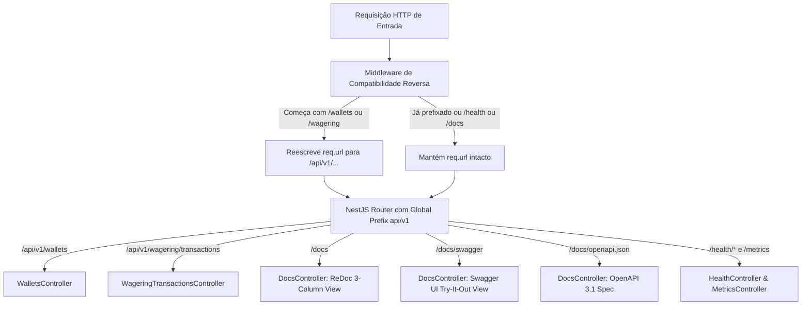

# RFC-0010 — Padronização de rotas RESTful com prefixo /api/v1 e documentação dual ReDoc e Swagger UI

## 1. Resumo

Este RFC define a evolução dos contratos de transporte HTTP da API para seguir os padrões rigorosos de engenharia de software e mercado em iGaming e serviços financeiros:
1. Versionamento explícito de namespace via prefixo canônico `/api/v1/` para todas as operações de negócio (`/api/v1/wallets`, `/api/v1/wagering/transactions`, etc.), com middleware de compatibilidade reversa transparente para requisições legadas.
2. Documentação dual sem templates HTML embutidos em controllers do backend:
   - **`GET /docs` (ReDoc)**: layout responsivo de 3 colunas padrão Zé Delivery / Docker / Stripe, com deep-linking (`#operation/...`) e geração de cURL para apresentação técnica e desenvolvedores de provedores de jogos.
   - **`GET /docs/swagger` (Swagger UI)**: console operacional com botão interativo *"Try it out"* para testes rápidos por avaliadores e engenheiros.
   - **`GET /docs/openapi.json`**: especificação OpenAPI 3.1 tipada e canônica consumida por ambos os motores.

## 2. Contexto e motivação

A Seção 9 de `docs/challenge/CHALLENGE.md` define as operações RESTful básicas da carteira e do motor de apostas (`/wallets`, `/wagering/transactions`).
No entanto, em ambientes produtivos de alto nível:
- Endpoints na raiz sem versionamento impedem evolução não-destrutiva de contratos de API. O padrão de mercado exige `/api/v1/...` para segregação de ciclo de vida.
- Roteamento de probes de orquestração (Kubernetes / AWS ALB em `/health/live`, `/health/ready` e `/metrics`) não deve se misturar com o tráfego de negócio dos provedores.
- Templates HTML acoplados e strings manuais dentro de controllers NestJS (`docs.controller.ts`) constituem anti-pattern ("HTML embutido em backend"), gerando fragilidade visual e bloqueios por Content Security Policy (CSP).
- Documentações corporativas modernas (como a do Zé Delivery) adotam o **ReDoc** para especificação pública de alto padrão de leitura, enquanto o **Swagger UI** supre a necessidade de console interativo de execução direta.

## 3. Objetivos e não-objetivos

**Objetivos**
- Estabelecer `/api/v1` como prefixo global do NestJS para todos os controllers de aplicação.
- Fornecer middleware de rewrite de compatibilidade reversa para requisições em `/wallets` e `/wagering` sem quebrar clientes legados ou testes do desafio.
- Expor `/docs` com ReDoc standalone oficial em 3 colunas idêntico ao padrão Zé Delivery (`seller-public-api.ze.delivery/docs#operation/...`).
- Expor `/docs/swagger` com Swagger UI interativo para execução com *"Try it out"*.
- Atualizar o `SecurityHeadersMiddleware` para autorizar estritamente os scripts e web workers do ReDocly e Swagger UI apenas nas rotas `/docs*`, mantendo política `default-src 'none'` para rotas financeiras.

**Não-objetivos**
- Não implementar autenticação com tela de login para a documentação pública (os endpoints continuam alinhados à Seção 2 do desafio).
- Não quebrar nem remover suporte às rotas legadas sem prefixo.

## 4. Desenho proposto

### 4.1 Arquitetura de Roteamento HTTP

### 4.2 Matriz de Endpoints

| Recurso | Rota Canônica (`v1`) | Rota de Compatibilidade | Âncora Deep-Link ReDoc |
|---|---|---|---|
| Abertura de Carteira | `POST /api/v1/wallets` | `POST /wallets` | `#operation/openWallet` |
| Consulta de Carteira | `GET /api/v1/wallets/:id` | `GET /wallets/:id` | `#operation/getWalletById` |
| Extrato do Ledger | `GET /api/v1/wallets/:id/ledger` | `GET /wallets/:id/ledger` | `#operation/getWalletLedger` |
| Submissão de Transação | `POST /api/v1/wagering/transactions` | `POST /wagering/transactions` | `#operation/processWagerTransaction` |
| Consulta de Transação | `GET /api/v1/wagering/transactions/:id` | `GET /wagering/transactions/:id` | `#operation/getWagerTransactionById` |
| Reconciliação de Saldo | `POST /api/v1/wallets/:id/reconcile` | `POST /wallets/:id/reconcile` | `#operation/reconcileWallet` |
| Liveness Probe | `GET /health/live` | `GET /health/live` | `#tag/Observability` |
| Readiness Probe | `GET /health/ready` | `GET /health/ready` | `#tag/Observability` |
| Métricas Prometheus | `GET /metrics` | `GET /metrics` | `#tag/Observability` |

## 5. Invariantes e garantias

| Invariante | Onde é garantida | Como é testada |
|---|---|---|
| Rotas de negócio respondem obrigatoriamente sob `/api/v1/...` | NestJS Global Prefix (`src/main.ts`) | Teste de integração HTTP com Bun test |
| Requisições sem prefixo continuam respondendo com status e payload idênticos | Middleware de rewrite transparente | Teste de integração validando chamadas a `/wallets` legadas |
| Rotas de infraestrutura (`/health/*`, `/metrics`, `/docs*`) não sofrem prefixação | Configuração de exclusão de prefixo | Testes de liveness, readiness e métricas |
| Segurança de cabeçalhos financeiros estrita (`default-src 'none'`) inalterada nas APIs | `SecurityHeadersMiddleware` | Teste unitário de middleware de segurança |
| CSP de `/docs*` restrito ao CDN oficial do Redocly e Swagger UI com `worker-src 'self' blob:` | `SecurityHeadersMiddleware` | Teste unitário de CSP com rota `/docs` |

## 6. Modos de falha

| Falha | Comportamento esperado | Teste |
|---|---|---|
| Cliente antigo envia chamada para `/wallets` sem `api/v1` | Middleware reescreve URL internamente e responde com 200/201 | Teste de integração HTTP chamando rota legada |
| Cliente envia chamada para rota inexistente `/api/v1/unknown` | Responde 404 padronizado pelo filtro de exceções | Teste de rota desconhecida |
| Navegador com CSP estrito acessa `/docs` | `worker-src 'self' blob:` permite inicialização dos workers do ReDoc sem erros no console | Teste de asserção de cabeçalho CSP |
| Indisponibilidade do CDN externo no ReDoc | Fallback estruturado orienta o usuário a acessar o Swagger local ou consultar o `/docs/openapi.json` | Teste unitário do container |

## 7. Alternativas consideradas

1. **Alterar rotas sem compatibilidade reversa**: Quebraria clientes ou suites de teste existentes que esperam os paths literais da Seção 9 do desafio. Descartada em favor de rewrite transparente.
2. **Adotar Docusaurus como aplicação externa separada**: Excelente para documentação de longa escala de repositório monorepo, mas adiciona complexidade de runtime e deploy separado para a entrega da API em container único. O ReDoc standalone atende perfeitamente ao visual do Zé Delivery em um único bundle.
3. **Manter apenas Swagger UI**: O Swagger UI tem visual de sanfona que não atende ao padrão de mercado de APIs públicas em 3 colunas solicitado.
4. **Manter apenas ReDoc**: O ReDoc é somente leitura na versão gratuita, impedindo que o avaliador execute testes práticos com o botão *"Try it out"*. Ter ambos é a solução ótima.

## 8. Observabilidade

- Todas as chamadas para `/api/v1/...` continuam gerando métricas de latência e contadores HTTP no Prometheus via `PrometheusMetricsAdapter`.
- Logs estruturados registram o `event: "http.request.completed"` com o path canônico `/api/v1/...`.

## 9. Plano de testes

- **Unidade**:
  - `test/unit/interfaces/docs-controller.spec.ts`: testar spec OpenAPI 3.1 com paths `/api/v1/`, endpoint ReDoc `/docs` e Swagger UI `/docs/swagger`.
  - `test/unit/interfaces/security-headers-middleware.spec.ts`: testar injeção de `worker-src` no `DOCS_CSP` e isolamento do `DEFAULT_CSP`.
- **Integração**:
  - Validar criação de carteira e processamento de apostas via `/api/v1/wallets` e `/api/v1/wagering/transactions`.
  - Validar compatibilidade reversa chamando `/wallets` diretamente.

## 10. Plano de implementação

- [x] Elaborar RFC-0010 e ADR-0023 no padrão docs-first.
- [ ] Configurar prefixo global `/api/v1` e middleware de compatibilidade em `src/main.ts`.
- [ ] Atualizar `src/interfaces/http/docs.controller.ts` para servir ReDoc oficial em 3 colunas e Swagger UI.
- [ ] Atualizar `src/interfaces/http/middlewares/security-headers.middleware.ts` com `worker-src 'self' blob:` e fontes do ReDoc.
- [ ] Atualizar testes unitários e de integração.
- [ ] Validar tipagem (`tsc --noEmit`), lint/format e regras arquiteturais.
- [ ] Abrir PR para `develop` e release `v1.0.6` para `main`.

## 11. Riscos e questões em aberto

- **Risco**: Cache de browser em chamadas anteriores de `/docs` com CSP antigo.
  - **Mitigação**: Resposta com cabeçalho `Cache-Control: no-cache, no-store, must-revalidate`.
