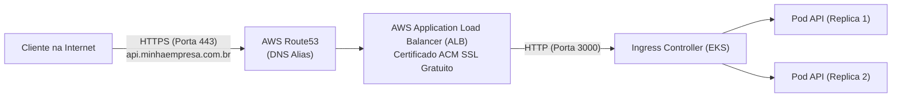

# Runbook 02 — Domínio Próprio, Route53, Certificados ACM & Ingress Público

Este runbook descreve como utilizar o domínio corporativo existente da sua empresa (ex.: `minhaempresa.com.br`) para expor a API do **Distributed Wagering Processor** com terminação TLS/HTTPS pública de alta disponibilidade e certificado SSL gratuito da AWS.

---

## 1. Arquitetura de Exposição Pública



---

## 2. Passo 1: Configurar a Zona de DNS no Route53

Se seu domínio já está registrado em outro provedor (ex.: Registro.br, GoDaddy, Cloudflare, etc.):

1. **Criar a Hosted Zone Pública no Route53**:
   ```bash
   aws route53 create-hosted-zone \
     --name "minhaempresa.com.br" \
     --caller-reference "$(date +%s)"
   ```
2. **Obter os Name Servers (NS) fornecidos pela AWS**:
   ```bash
   aws route53 get-hosted-zone --id <HOSTED_ZONE_ID> --query "DelegationSet.NameServers"
   # Exemplo:
   # [
   #   "ns-123.awsdns-15.com",
   #   "ns-456.awsdns-57.net",
   #   "ns-789.awsdns-34.org",
   #   "ns-012.awsdns-01.co.uk"
   # ]
   ```
3. **Delegar no seu Registrador de Domínio**:
   - Acesse o painel do seu registrador de domínio (ex: Registro.br).
   - Edite os Servidores DNS do domínio (ou crie um subdomínio delegado como `wagering.minhaempresa.com.br`).
   - Insira os 4 Name Servers informados pelo Route53.

---

## 3. Passo 2: Emitir Certificado SSL/TLS Gratuito no AWS Certificate Manager (ACM)

O ACM emite e renova automaticamente certificados públicos SSL de forma 100% gratuita.

1. **Solicitar o Certificado para o subdomínio da API**:
   ```bash
   aws acm request-certificate \
     --domain-name "api.minhaempresa.com.br" \
     --validation-method DNS \
     --subject-alternative-names "*.minhaempresa.com.br" \
     --region us-east-1
   ```
2. **Validar a Propriedade do Domínio via DNS**:
   - O comando acima retornará um registro CNAME para validação.
   - O arquivo [`infra/terraform/route53_acm.tf`](../../infra/terraform/route53_acm.tf) cria automaticamente esse registro de validação no Route53 quando `var.domain_name` for fornecido.
   - Em poucos minutos, o status do certificado no ACM passará para `ISSUED`.
3. Anote o ARN do Certificado:
   ```bash
   aws acm list-certificates --query "CertificateSummaryList[?DomainName=='api.minhaempresa.com.br'].CertificateArn" --output text
   # Exemplo: arn:aws:acm:us-east-1:123456789012:certificate/abc-123-def
   ```

---

## 4. Passo 3: Configurar o Ingress no Helm com o AWS Load Balancer Controller

No arquivo [`infra/helm/distributed-wagering-processor/values-prod.yaml`](../../infra/helm/distributed-wagering-processor/values-prod.yaml), configure as anotações do Ingress:

```yaml
ingress:
  enabled: true
  className: alb
  annotations:
    alb.ingress.kubernetes.io/scheme: internet-facing
    alb.ingress.kubernetes.io/target-type: ip
    alb.ingress.kubernetes.io/listen-ports: '[{"HTTP": 80}, {"HTTPS": 443}]'
    alb.ingress.kubernetes.io/ssl-redirect: '443'
    alb.ingress.kubernetes.io/certificate-arn: arn:aws:acm:us-east-1:SEU_ACCOUNT_ID:certificate/SEU_CERTIFICATE_ID
    alb.ingress.kubernetes.io/healthcheck-path: /health/live
    alb.ingress.kubernetes.io/healthcheck-interval-seconds: '15'
  hosts:
    - host: api.minhaempresa.com.br
      paths:
        - path: /
          pathType: Prefix
```

Quando o Helm chart for aplicado, o **AWS Load Balancer Controller** provisionará um Application Load Balancer (ALB) público na AWS e associará o certificado SSL.

---

## 5. Passo 4: Criar o Registro DNS Alias no Route53

Após a criação do ALB pelo Kubernetes:

1. Obtenha o DNS do ALB criado:
   ```bash
   kubectl get ingress -n wagering wagering-processor-ingress -o jsonpath='{.status.loadBalancer.ingress[0].hostname}'
   # Exemplo: k8s-wagering-wagering-1234567890.us-east-1.elb.amazonaws.com
   ```
2. Crie o registro Alias (tipo A) no Route53 apontando `api.minhaempresa.com.br` para o ALB:
   - Se estiver usando o Terraform, o arquivo `route53_acm.tf` gerencia o apontamento.
   - Ou via AWS Console: no Route53, crie um registro do tipo `A`, marque `Alias = Yes`, escolha `Alias to Application and Classic Load Balancer`, selecione a região `us-east-1` e o ALB correspondente.

---

## 6. Passo 5: Teste de Acesso Público pela Internet

A partir de qualquer terminal ou máquina externa:

```bash
# 1. Testar o healthcheck com HTTPS e TLS válido:
curl -i https://api.minhaempresa.com.br/health/live

# Resposta esperada:
# HTTP/2 200 
# content-type: application/json; charset=utf-8
# {"status":"ok","timestamp":"2026-10-23T12:00:00.000Z"}

# 2. Criar uma carteira via internet:
curl -X POST https://api.minhaempresa.com.br/wallets \
  -H "Content-Type: application/json" \
  -d '{"playerId": "p-100", "currency": "BRL", "initialBalance": "500.00"}'
```
